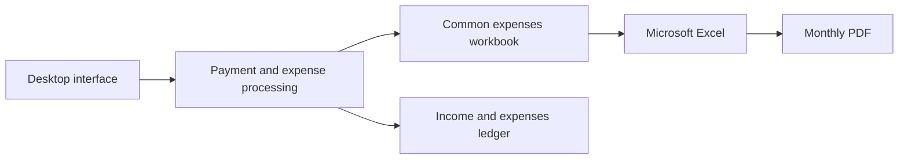

# Building Expense Manager

A Python desktop app for managing monthly building expenses. It uses two Excel workbooks, supports up to 15 apartments and has a Greek and English interface.

[Ελληνικά](README_GR.md) · [User guide](docs/USER_GUIDE_EN.md) · [Testing](docs/TESTING.md)

## Why I built it

I used to record payments, carry balances forward, split expenses and prepare the monthly report by hand in Excel. That took me about 30–60 minutes a month. With the app, I usually finish in less than five minutes. These times are my own estimates from using it.

## What it does

- Splits owner and tenant expenses proportionally and allocates every cent. Heating uses weighted floor area.
- Records actual payments and carries debts and credits into the next month.
- Checks the charges against the expenses and reconciles the cash ledger before saving.
- Creates monthly Excel sheets and can export a PDF. Deleting the latest month and its PDF requires confirmation.

## Technology

Python · Tkinter · openpyxl · xlwings · python-dateutil · Microsoft Excel



## Screenshots

See the [screenshots gallery](docs/screenshots/README.md) for the application workflow and Excel report, and the [sample report folder](examples/sample-output/README.md) for an illustrative PDF.

## Requirements

- Python 3.11 or later, with versions of the packages that support your interpreter.
- An installed, activated copy of desktop Microsoft Excel.
- Tkinter and the packages in `requirements.txt`.
- The two supplied blank XLSX templates, with their original cell layout and formulas.

## Quick start

Download or clone the repository. In a terminal at its root:

**Windows (PowerShell):**

```powershell
py -m venv .venv
.\.venv\Scripts\python.exe -m pip install -r requirements.txt
.\.venv\Scripts\python.exe main.py
```

**macOS:**

```bash
python3 -m venv .venv
.venv/bin/python -m pip install -r requirements.txt
.venv/bin/python main.py
```

Before you start, copy both blank files from `templates/` to a private folder outside the repository. Keep their Greek filenames and close the copies in Excel. Choose your language and select the copies when the app asks for the workbooks.

## Monthly workflow

1. Configure the building, opening balance and property details.
2. Start the next monthly cycle and enter payments.
3. Enter recurring expenses and any additional owner or tenant expenses.
4. Confirm the update and optionally generate the monthly PDF.
5. Verify the report and ledger against the original records.

Use `0` to exclude an apartment from heating. A factor of `0.25` gives it a quarter of its usual floor-area weight. Use `1` or leave the field blank for full weight.

## Testing

```bash
python -m unittest discover -s tests -v
```

The regression suite covers payments, allocation, month creation, workbook validation and recovery. The GitHub Actions workflow runs without Excel or the GUI. Two monthly runs and a PDF export were compared against the previous checkpoint in desktop Excel on Windows 10, using simulated form inputs. See [TESTING.md](docs/TESTING.md) for test scope and the remaining manual checks.

## Limitations and data safety

- The app uses the supplied 15-slot workbook layout and the allocation rules of this building.
- Desktop Excel recalculates formulas and exports PDFs. Workbooks and reports use Greek labels.
- Files stay local. Close the working documents before an update and keep separate backups. An interruption can leave one workbook updated before the other.
- Never commit live accounting documents, personal information or local settings. Use only blank templates and synthetic demonstration assets.

## Author and license

Vasilios Valatsos developed the app with AI assistance for parts of the implementation.

The Python code is available under the [MIT License](LICENSE). The author has confirmed permission to distribute the blank workbook templates. See [ASSET_LICENSE.md](docs/ASSET_LICENSE.md) for accompanying assets.
