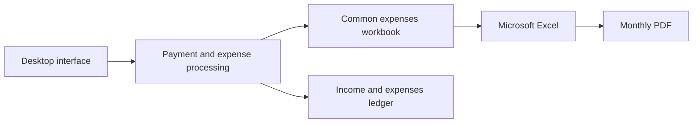

# Building Expense Manager

A bilingual Python desktop application that automates monthly common-expense allocation, payment tracking and financial reporting for a residential building with 15 apartment slots.

[Ελληνικά](README_GR.md) · [User guide](docs/USER_GUIDE_EN.md) · [Testing](docs/TESTING.md)

## Problem and impact

Monthly building management previously required repetitive manual work across Excel workbooks: recording payments, carrying forward balances, allocating expenses and preparing a report. This application consolidates these steps into a guided workflow.

**Reported real-world processing time:** approximately 30–60 minutes manually, reduced to under 5 minutes using the application (developer's own operational estimate; not a controlled benchmark).

## Features

- Greek and English graphical interface with a single application entry point.
- Property and occupant records, including heating participation factors.
- Monthly payment entry, debt carry-forward and credit balances.
- Separate allocation of owner and tenant expenses.
- Excel-based accounting and monthly PDF export.
- Confirmed deletion of the latest monthly sheets and matching PDF.
- Input validation and safeguards against incomplete monthly updates.

## Technology

Python · Tkinter · openpyxl · xlwings · python-dateutil · Microsoft Excel



## Screenshots

See the [screenshots gallery](docs/screenshots/README.md) for the application workflow and Excel report, and the [sample report folder](examples/sample-output/README.md) for an illustrative PDF.

## Requirements

- Python 3.11 or newer recommended (use a version compatible with your installed dependencies).
- Microsoft Excel desktop, installed and activated. Excel Online alone is not sufficient.
- Tkinter and the packages in `requirements.txt`.
- The two supplied blank XLSX templates, with their original cell layout and formulas.

The developer reports successful manual testing of the final bilingual application on Windows 10 and macOS. Other operating system versions and packaged executables are not certified.

## Quick start

Download or clone the repository. In a terminal at its root:

**Windows (PowerShell):**

```powershell
py -m venv .venv
.\.venv\Scripts\python.exe -m pip install -r requirements.txt
.\.venv\Scripts\python.exe main.py
```

**macOS:**

```bash
python3 -m venv .venv
.venv/bin/python -m pip install -r requirements.txt
.venv/bin/python main.py
```

Before first use, copy the two blank files from `templates/` to a private working folder outside the repository. Keep their Greek filenames. Close those files in Excel, choose your language and select the working copies when prompted. The originals should remain unchanged.

## Monthly workflow

1. Configure the building, opening balance and property details.
2. Start the next monthly cycle and enter payments.
3. Enter recurring expenses and any additional owner or tenant expenses.
4. Confirm the update and optionally generate the monthly PDF.
5. Verify the report and ledger against the original records.

Heating factors: `0` = exempt; `0.25` = 25% weighting; `1` or blank = full weighting. A factor is a relative allocation weight, not a fixed percentage of the final bill.

## Testing

```bash
python -m unittest discover -s tests -v
```

The automated suite checks the expected helper-function interface, numeric input, payment allocation, month creation, heating safeguards, deletion and workbook structure. GitHub Actions runs headless tests; it does not launch Excel or the GUI. See [TESTING.md](docs/TESTING.md) for scope and manual acceptance checks.

## Limitations and data safety

- Designed for the supplied fixed 15-slot workbook structure; not general-purpose accounting software.
- Desktop Excel is necessary for formula recalculation and PDF export. The interface is bilingual, but the supplied workbooks and generated reports use Greek labels.
- Local file-based storage. Close working documents before updates; keep independent backups. Two-file updates cannot be guaranteed atomic during system crashes.
- Never commit live accounting documents, personal information or local settings. Use only blank templates and synthetic demonstration assets.
- Allocation rules reflect this building's workflow, not universal legal or accounting rules.

## Author and license

Developed by **Vasilios Valatsos**, with AI assistance at selected implementation stages.

The Python code is available under the [MIT License](LICENSE). The author has confirmed permission to distribute the blank workbook templates. See [ASSET_LICENSE.md](docs/ASSET_LICENSE.md) for accompanying assets.
