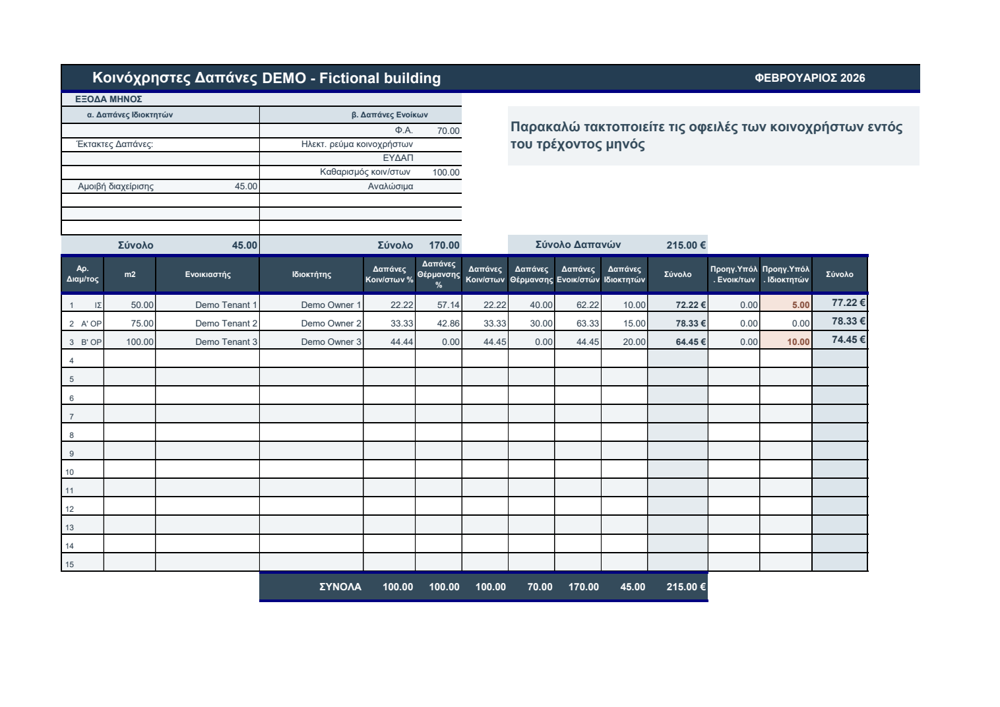
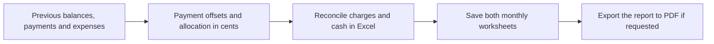

# Building Expense Manager

A Python desktop app for managing monthly building expenses. It uses two Excel workbooks, supports up to 15 apartments and has a Greek and English interface.

[Ελληνικά](README_GR.md) · [User guide](docs/USER_GUIDE_EN.md) · [Testing](docs/TESTING.md)



[Screenshots](docs/screenshots/README.md) · [Download the demo and follow the calculations](examples/sample-output/README.md)

## Why I built it

I used to record payments, carry balances forward, split expenses and prepare the monthly report by hand in Excel. That took me about 30–60 minutes a month. With the app, I usually finish in less than five minutes. These times are my own estimates from using it.

## What it does

- Splits owner and tenant expenses proportionally and allocates every cent. Heating uses weighted floor area.
- Records actual payments and carries debts and credits into the next month.
- Checks the charges against the expenses and reconciles the cash ledger before saving.
- Creates monthly Excel sheets and can export a PDF. Deleting the latest month and its PDF requires confirmation.

## How the month is calculated



Payments first offset debts and credits within each apartment. Cash goes to the tenant's debt first, then to the owner's. An overpayment becomes a tenant credit. The ledger records cash received, while the common-expenses workbook shows charges and outstanding balances.

For each expense, the app calculates proportional shares using floor area, or floor area multiplied by a heating factor. It allocates whole cents first, then gives the remaining cents to the largest fractional remainders. In a tie, the earlier apartment row comes first. This is the Largest Remainder method. The app checks that the allocations add up to the expense and that opening cash plus receipts minus actual outflows equals closing cash.

In the demo, three apartments of 50, 75 and 100 m² split a €100 cleaning bill into **€22.22, €33.33 and €44.45**. February starts with €515 in cash. It receives €70 and pays €215 in expenses, so it closes with **€370**. The [full example](examples/sample-output/README.md) shows how a tenant credit offsets an owner's debt without creating a cash receipt.

## Setup

The app uses Python, Tkinter and openpyxl. It uses xlwings to recalculate and export through desktop Microsoft Excel and python-dateutil to advance the reporting month. Use Python 3.11 or later with compatible dependencies, Tkinter and an installed, activated copy of Excel. Keep the two blank XLSX templates and their sheet layouts intact.

Download or clone the repository. In a terminal at its root:

**Windows (PowerShell):**

```powershell
py -m venv .venv
.\.venv\Scripts\python.exe -m pip install -r requirements.txt
.\.venv\Scripts\python.exe main.py
```

**macOS:**

```bash
python3 -m venv .venv
.venv/bin/python -m pip install -r requirements.txt
.venv/bin/python main.py
```

Before you start, copy both blank files from `templates/` to a private folder outside the repository. Keep their Greek filenames and close the copies in Excel. Choose your language and select the copies when the app asks for the workbooks.

## Monthly workflow

1. Configure the building, opening balance and property details.
2. Start the next monthly cycle and enter payments.
3. Enter recurring expenses and any additional owner or tenant expenses.
4. Confirm the update and optionally generate the monthly PDF.
5. Verify the report and ledger against the original records.

Use `0` to exclude an apartment from heating. A factor of `0.25` gives it a quarter of its usual floor-area weight. Use `1` or leave the field blank for full weight.

## Testing

```bash
python -m unittest discover -s tests -v
```

The 47 regression tests cover payments, allocation, month creation, workbook validation and recovery. The presentation samples were generated and checked in desktop Excel 16.0 on Windows 10 with Python 3.15.2, using fictional inputs supplied to the app's monthly workflow. See [TESTING.md](docs/TESTING.md) for the CI matrix, earlier macOS checks and the remaining manual acceptance tests.

## Limitations and data safety

- The app uses the supplied 15-slot workbook layout and the allocation rules of this building.
- Desktop Excel recalculates formulas and exports PDFs. Workbooks and reports use Greek labels.
- Files stay local. Close the working documents before an update and keep separate backups. An interruption can leave one workbook updated before the other.
- Never commit live accounting documents, personal information or local settings. Use only blank templates and synthetic demonstration assets.

## Author and license

Vasilios Valatsos developed the app with AI assistance for parts of the implementation.

The Python code is available under the [MIT License](LICENSE). The author has confirmed permission to distribute the blank workbook templates. See [ASSET_LICENSE.md](docs/ASSET_LICENSE.md) for accompanying assets.
