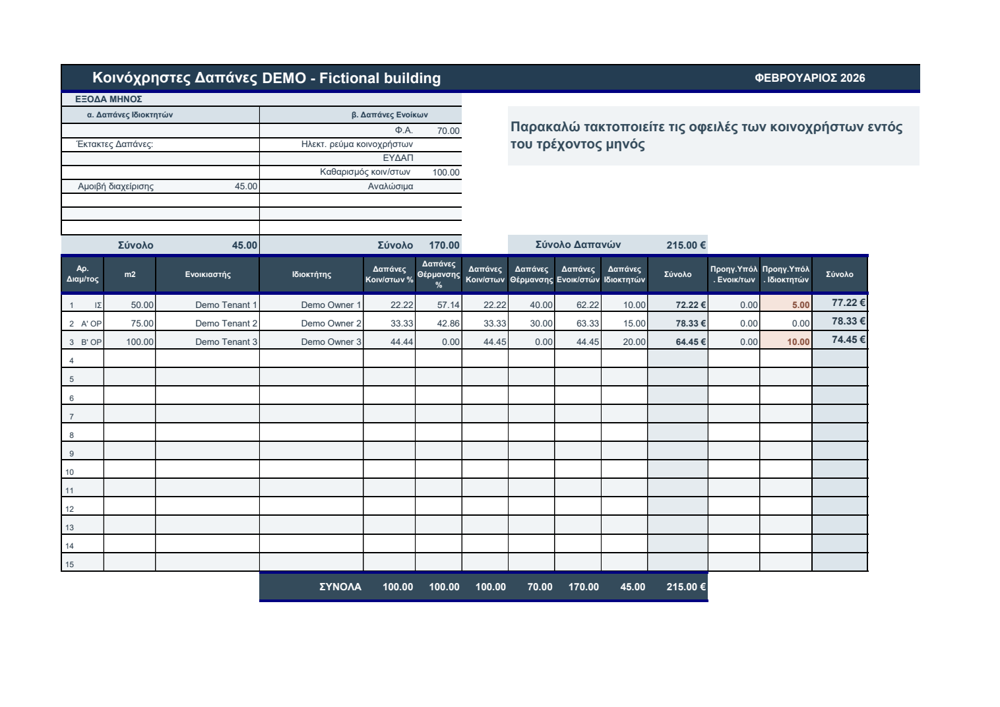

# Building Expense Manager (Διαχείριση κοινοχρήστων)

Εφαρμογή Python για τα μηνιαία κοινόχρηστα μιας πολυκατοικίας. Χρησιμοποιεί δύο βιβλία Excel, υποστηρίζει έως 15 ιδιοκτησίες και έχει περιβάλλον στα ελληνικά και στα αγγλικά.

[English](README.md) · [Οδηγίες χρήσης](docs/USER_GUIDE_GR.md) · [Δοκιμές](docs/TESTING.md)



[Στιγμιότυπα εφαρμογής](docs/screenshots/README.md) · [Αρχεία και υπολογισμοί του παραδείγματος](examples/sample-output/README.md)

## Γιατί έφτιαξα την εφαρμογή

Περνούσα τις πληρωμές στο Excel, μετέφερα τα υπόλοιπα, μοίραζα τις δαπάνες και έβγαζα τη μηνιαία κατάσταση με το χέρι. Μου έπαιρνε περίπου 30–60 λεπτά τον μήνα. Με την εφαρμογή συνήθως τελειώνω σε λιγότερο από πέντε λεπτά. Είναι δικές μου εκτιμήσεις από τη χρήση της.

## Τι κάνει

- Επιμερίζει αναλογικά τις δαπάνες ιδιοκτητών και ενοικιαστών, μέχρι το τελευταίο λεπτό. Για τη θέρμανση χρησιμοποιεί τα σταθμισμένα τετραγωνικά.
- Καταγράφει τις εισπράξεις και μεταφέρει χρεωστικά και πιστωτικά υπόλοιπα στον επόμενο μήνα.
- Συγκρίνει τις χρεώσεις με τις δαπάνες και ελέγχει το ταμείο πριν αποθηκεύσει.
- Δημιουργεί μηνιαία φύλλα Excel και εξάγει προαιρετικά PDF. Η διαγραφή του τελευταίου μήνα και του PDF του χρειάζεται επιβεβαίωση.

## Πώς υπολογίζεται ο μήνας

Η εφαρμογή συμψηφίζει τις πιστώσεις με τις οφειλές της ίδιας ιδιοκτησίας. Η πληρωμή καλύπτει πρώτα την οφειλή του ενοικιαστή και μετά του ιδιοκτήτη. Αν περισσέψει ποσό, μένει ως πίστωση του ενοικιαστή. Στο βιβλίο ταμείου περνά μόνο το ποσό που εισπράχθηκε.

Κάθε δαπάνη επιμερίζεται με βάση τα τετραγωνικά. Για τη θέρμανση, τα τετραγωνικά πολλαπλασιάζονται με τον συντελεστή συμμετοχής. Η μέθοδος των μεγαλύτερων υπολοίπων δίνει πρώτα τα ακέραια λεπτά και μοιράζει όσα περισσεύουν κατά σειρά κλασματικού υπολοίπου. Σε ισοβαθμία προηγείται η γραμμή της ιδιοκτησίας στο φύλλο. Πριν αποθηκεύσει, η εφαρμογή ελέγχει ότι οι χρεώσεις αθροίζουν στη δαπάνη και ότι το κλείσιμο του ταμείου συμφωνεί με το άνοιγμα, τις εισπράξεις και τις εκροές.

Στο παράδειγμα, τρεις ιδιοκτησίες 50, 75 και 100 τ.μ. μοιράζονται €100 καθαρισμού σε **€22,22, €33,33 και €44,45**. Το ταμείο του Φεβρουαρίου ανοίγει με €515, εισπράττει €70, πληρώνει €215 και κλείνει με **€370**. Στο [πλήρες παράδειγμα](examples/sample-output/README.md) φαίνεται και ένας συμψηφισμός πίστωσης που δεν δημιουργεί είσπραξη.

## Εγκατάσταση

Η εφαρμογή χρησιμοποιεί Python, Tkinter και openpyxl. Χρησιμοποιεί xlwings για επανυπολογισμό και εξαγωγή μέσω του Excel και python-dateutil για τη μετάβαση στον επόμενο μήνα. Χρειάζεσαι Python 3.11 ή νεότερη με συμβατές βιβλιοθήκες, Tkinter, εγκατεστημένο και ενεργοποιημένο Microsoft Excel και τα δύο κενά πρότυπα.

Windows:

```powershell
py -m venv .venv
.\.venv\Scripts\python.exe -m pip install -r requirements.txt
.\.venv\Scripts\python.exe main.py
```

macOS:

```bash
python3 -m venv .venv
.venv/bin/python -m pip install -r requirements.txt
.venv/bin/python main.py
```

Αντέγραψε τα δύο κενά πρότυπα από το `templates/` σε ιδιωτικό φάκελο εκτός αποθετηρίου. Κράτησε τα ελληνικά ονόματα και κλείσε τα αντίγραφα στο Excel. Στην εφαρμογή διάλεξε γλώσσα και επίλεξε τα αντίγραφα όταν σου ζητήσει τα βιβλία.

Καταχώρισε το αρχικό ταμείο και τις ιδιοκτησίες. Κάθε μήνα, πέρασε τις πληρωμές και τις δαπάνες, επιβεβαίωσε την αποθήκευση και διάλεξε αν θέλεις PDF. Πριν χρησιμοποιήσεις την αναφορά, σύγκρινε τα δύο βιβλία με τα παραστατικά σου. Για τη θέρμανση, το `0` εξαιρεί την ιδιοκτησία, το `0.25` δίνει ένα τέταρτο του βάρους της και το `1` ή κενό δίνει πλήρες βάρος.

## Δοκιμές και περιορισμοί

```bash
python -m unittest discover -s tests -v
```

Οι 47 δοκιμές παλινδρόμησης καλύπτουν τις πληρωμές, τον επιμερισμό, τη δημιουργία μήνα, τον έλεγχο των βιβλίων και την ανάκτηση. Τα δείγματα δημιουργήθηκαν και ελέγχθηκαν σε Excel 16.0, σε Windows 10 με Python 3.15.2, με πλασματικές εισόδους στη μηνιαία ροή της εφαρμογής. Στο [TESTING.md](docs/TESTING.md) αναφέρονται η μήτρα CI, οι έλεγχοι προηγούμενης έκδοσης σε macOS και οι χειροκίνητες δοκιμές που εκκρεμούν.

Η εφαρμογή χρησιμοποιεί τη διάταξη 15 θέσεων και τους κανόνες κατανομής της συγκεκριμένης πολυκατοικίας. Το Excel επανυπολογίζει τους τύπους και εξάγει PDF. Τα φύλλα και οι αναφορές έχουν ελληνικές ετικέτες. Τα αρχεία μένουν στον υπολογιστή σου. Κλείσε τα πριν από ενημέρωση και κράτησε ξεχωριστά αντίγραφα ασφαλείας. Μια διακοπή μπορεί να αφήσει ενημερωμένο μόνο το ένα βιβλίο. Μην ανεβάζεις πραγματικά προσωπικά ή οικονομικά στοιχεία.

## Δημιουργός

Ο Vasilios Valatsos ανέπτυξε την εφαρμογή με βοήθεια AI σε επιμέρους σημεία. Ο κώδικας διατίθεται με την [MIT License](LICENSE).

Οι όροι για τα πρότυπα και το συνοδευτικό υλικό περιγράφονται στο [ASSET_LICENSE.md](docs/ASSET_LICENSE.md).
