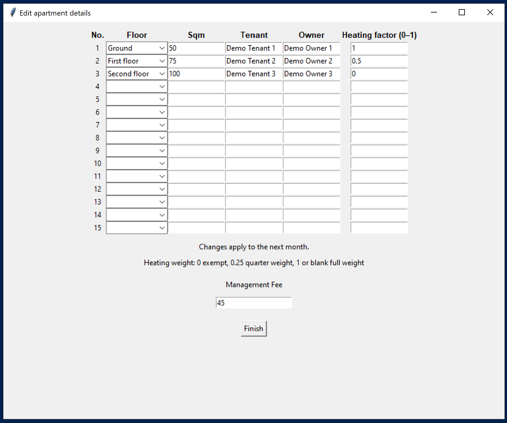
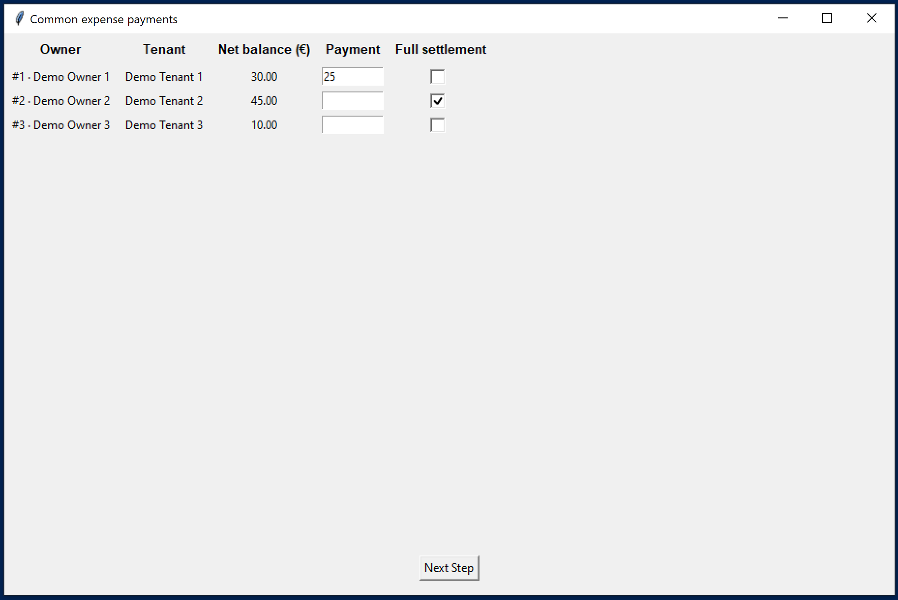
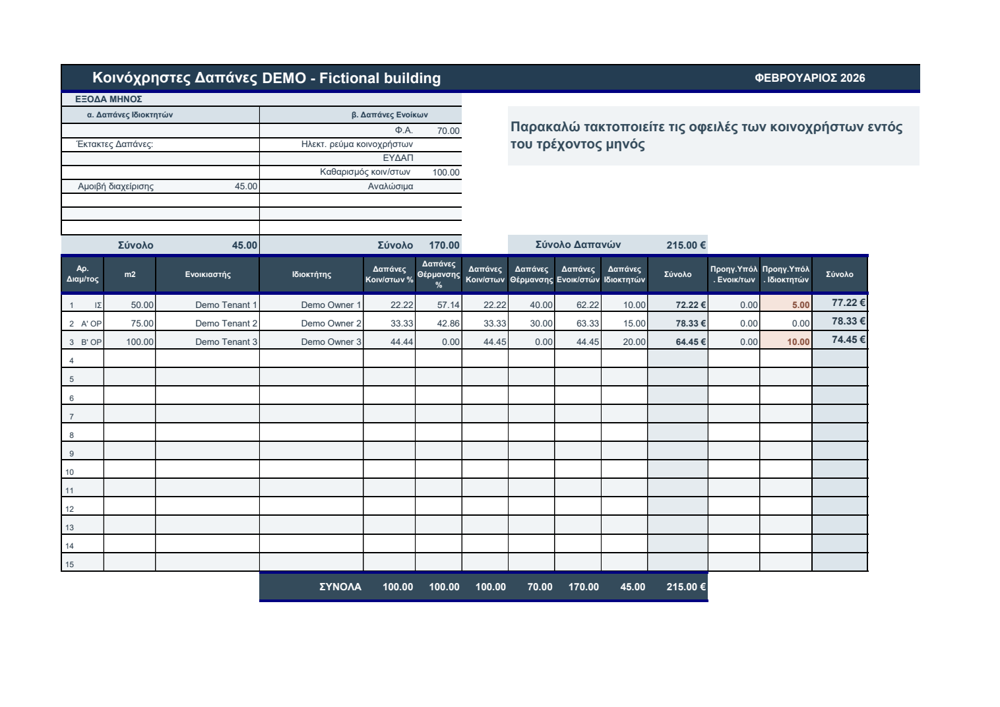

# Application and reports

The four application windows show the current English interface with fictional data from the [February 2026 demo](../../examples/sample-output/README.md). The payments screen shows entry before settlement. The Excel ledger and PDF previews are rendered from the actual Excel worksheet and the PDF the app exported.

### Dashboard

### Property settings

### Payments

### Expenses

### Excel report

### Generated PDF

## Capture checklist

Recreate January and February from the [demo instructions](../../examples/sample-output/README.md), using fresh private copies of the blank workbooks. Capture only the app window or worksheet range. Keep personal files, Excel account details and local paths out of the images.

| Filename | Screen and inputs | What to capture | Placement and language |
| --- | --- | --- | --- |
| `dashboard.png` | Open the welcome screen after choosing English. Select the demo workbooks if prompted. | The current title and the **Start next month**, **Edit apartment details** and **Change workbooks** buttons. | Gallery, Dashboard. English. |
| `edit-data.png` | Open **Edit apartment details** after setting up the three demo properties. | The three fictional names, areas 50/75/100, factors 1/0.5/0 and the €45 management fee. | Gallery, Property settings. English. |
| `payments.png` | Start February from the workbooks after January. Enter 25 for row 1. Select **Full settlement** for row 2 and leave its amount field blank. Leave row 3 blank. | Net balances of 30.00, 45.00 and 10.00 before submission. Capture row 2's checked box and row 3's empty payment field. | Gallery, Payments. English. |
| `expenses.png` | Continue from February's payments. Enter 70 for natural gas and 100 for common-area cleaning. Leave other fields blank. | Both amounts and the **Finish and export PDF** button, before saving. | Gallery, Expenses. English. |
| `excel-report.png` | Recalculate the February ledger from the ZIP. Print or capture `B2:N35`. | Demo building name, €515 opening, €25 and €45 receipts, €585 income-side total, €215 expenses and €370 closing. | Gallery, Excel report. Greek workbook labels. Preview updated. |
| `pdf-report.png` | Open the February report generated by the app. Render the complete page. | The demo label, €215 new charges and row balances of €77.22, €78.33 and €74.45. | Both main READMEs and gallery, Generated PDF. Greek report labels. Preview updated. |
